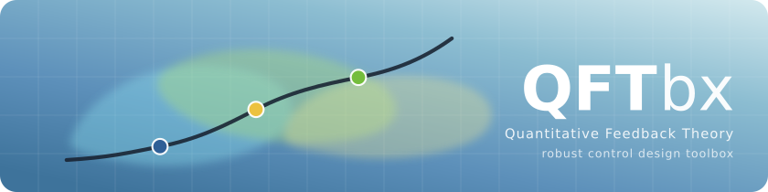

# QFTbx architecture

QFTbx is a desktop toolbox for robust controller design with Quantitative Feedback
Theory (QFT). The application walks the user through the standard QFT pipeline; each
stage has a dialog in the GUI and an engine in the model layer.

## The QFT pipeline

```
 plant + parametric     design           templates          specifications
 uncertainty        →   frequencies  →   (value sets +  →   (stability,
                        (ω vector)       ε-hull contour)    tracking, ...)
                                                                 │
                        controller   ←   automatic loop  ←   boundaries
                        structure        shaping             (Nichols plane)
```

1. **Plant**: transfer function with parametric uncertainty. Several input formats
   (gain/pole-zero forms, polynomial coefficients, free-format expression in `s`
   evaluated by the toolbox's own expression tree).
2. **Design frequencies (ω)**: linear/log spacing or manual values.
3. **Templates**: for each ω, the set of possible plant responses in the Nichols plane
   (brute-force sweep over the uncertain parameters) reduced to its contour with the
   ε-hull algorithm (Nordin 1993, in Montoya's implementation).
4. **Specifications**: robust stability and performance bounds.
5. **Boundaries**: for each ω and specification, the allowed/forbidden regions for the
   nominal open loop, computed on a phase×magnitude grid and traced with a contour
   follower; per-frequency boundaries are then merged (1D intersection algorithm).
6. **Loop shaping**: automatic controller synthesis honouring the boundaries (interval
   arithmetic; several algorithms).

Each algorithm, its reference and how the implementation follows it are described
in [docs/algorithms](algorithms/README.md).

## Modules

| Directory | Contents |
|---|---|
| `src/core/common/` | `qftbx::Exception` and its subclasses; number and token text helpers |
| `src/core/math/` | Numeric helpers (`linspace`/`logspace`), ranges and points, constants, the roots of a real polynomial and the polynomial behind a function that can only be evaluated (`polynomial.h`), and the expression tree: the one expression engine of the toolbox (see below) |
| `src/core/system/` | Plant/controller representation: `LtiSystem` hierarchy, transfer functions, parameters. A system also places its own poles (`polesAt`), which is what the stability criterion asks of a plant |
| `src/core/frequencies/` | The design frequency set (`Omega`) |
| `src/core/specifications/` | Validated specification set (`qftbx::Specification`) |
| `src/core/templates/` | Brute-force template computation and ε-hull contour (`TemplateEngine`); the plan of the sweep and its run on the processor (`sweep_plan.h`), shared with the GPU; the cloud prepared for the walk, its order, projection and ε-connected parts (`walk_cloud.h`), which the GPU may hand over instead |
| `src/core/boundaries/` | Boundary computation: the checks and the specifications of each frequency (`boundary_plan.h`), sheets (`BoundaryEngine`, which also takes the sheets, or the traces and columns read off them, computed on the GPU), contour tracing (`ContourTracer`), 1D union (`BoundaryUnion1D`), results view (`BoundaryData`) |
| `src/core/loopshaping/` | The loop-shaping entry point and its result; `common/` holds what the algorithms share (the interval projection, the box classification, the nominal stability check, the search list, the Quick Solution cuts) and `nt/`, `nk/`, `mr/`, `mc1/`, `mc_thesis/`, `mc2/`, `mc3/` one algorithm each |
| `src/core/project/` | What a project holds, owned by value (`ProjectData`); the user settings (`Settings`) |
| `src/core/pipeline/` | The design steps as data (`Step`), one stage per step, background execution and cancellation |
| `src/core/gpu/` | The GPU engines (`USE_CUDA`): a library of their own, `qftbx_cuda`, that implements what the core declares, the engine of each phase (`TemplateComputation`, `BoundaryComputation`) and the provider of them (`src/core/pipeline/gpu_provider.h`), which the application installs at start; `common/` is the base, from the errors, memory and streams to the probe of the card, `templates/` the check of the family's poles, one warp per distinct denominator, the sweep of the plant family on the card, with a free-form plant run as the postfix programs of its expression and of its denominator (`src/core/math/expression_program.h`), and the contours, the clouds sorted, projected and split into their ε-connected parts by radix sorts and a union-find without locks, every part walked by a warp, or the alpha-shape's edges tested by warps and its faces walked by a thread per component, and the epsilon proposal, the minimum spanning tree and the diameter by a block per frequency and the climb walked in rounds, and `boundaries/` the sheets of the boundaries, worst case and guard near the singular locus, bounded in single precision and decided in double, and read where they are into traces, their labels and columns |
| `src/persistence/` | Load/save of `.qft` project files (pugixml; the version-2 dialect, see [PROJECT_FORMAT.md](PROJECT_FORMAT.md)) |
| `src/app/` | `ProjectController`: the single mediator between GUI and core, one method per design step |
| `src/gui/` | Qt Widgets HMI: one folder per design step with its dialog and viewers (QCustomPlot), plus `application/` (shell, main window) and `common/` (shared widgets and helpers) |
| `src/bench/` | The benchmark library and the `qftbx-bench` tool (plans, measured runs in their own processes, summaries), and `src/gui/bench/` its planner; only with `QFTBX_BUILD_BENCHMARK`, see [BENCHMARKING.md](BENCHMARKING.md) |
| `tests/` | GoogleTest suites in `backend/` and `gui/` (and `bench/` with the benchmark, `gpu/` with CUDA); golden `.qft` projects in `tests/data/` |

Build targets: `qftbx_core` (the algorithms and the model), `qftbx_persistence`,
`qftbx_app` (the mediator), `qftbx_gui`, and the `QFTbx` executable on top of them;
`qftbx_tests` links the facade. With CUDA, `qftbx_cuda` sits between the core and the
mediator: it depends on the core, and the core never on it. Every folder has a `CMakeLists.txt` that adds its own
files to the target it belongs to (`cmake/QftbxFunctions.cmake`), so no file list is
kept by hand.

## The GPU engines

The GPU engines implement the same interfaces as the processor's
(`TemplateComputation`, `BoundaryComputation`), and each holds an engine of
the processor that keeps the settings and the results and does what is left
on the processor. The template engine checks the family's poles, sweeps it,
proposes epsilon and walks or shapes the contours on the card; the
processor's engine finishes the contours (the whole cloud standing in for
one that does not close, the reports) from what comes back. The boundary
engine computes the sheets and reads them on the card into traces, their
labels and columns; the union of each frequency and the closed-form columns
stay on the processor, and so does the loop shaping.

The data stay on the card between phases. The clouds of a sweep stay there,
and the proposal, the contours and the boundaries from the whole cloud read
them there; clouds computed on the processor or read from a file go up once,
the first time a step on the GPU needs them, and stay until the templates
change (`TemplateStage::cloudsOnCard`). The core passes them along as
`ResidentClouds` without knowing what they are. Only what the processor
needs comes back: the clouds after the sweep, for the project and the
plots, the contours, and the traces and columns.

A phase goes in batches of frequencies that half the card's free memory
holds, and stops between them when the computation is cancelled; the long
kernels (the walk, the spanning tree, the faces of the alpha-shape, the
sheets) also ask for it while they run, one thread for its warp or its
block. A failure on the card is a `ComputationError` with CUDA's text, and
each phase writes to the program's record what it cost on the card.

Everything is in double precision; the sheets bound their extremes in
single precision first and decide in double, and `USE_FP_CONTRACTION=OFF`
compiles the kernels with `--fmad=false`. The card's square root, arc
tangent and logarithm are not the processor's, so its results agree with
the processor's to rounding, not to the bit: the same clouds to their last
bits, contours within epsilon of each other, the same proposals. The step
of the templates and that of the boundaries choose the processor in the
interface; the first choice is the settings' (`defaults.templates.gpu`), and
every step opens with the last one made.

## Expressions

Every expression the toolbox reads goes through `ExpressionTree`
(`src/core/math/expression_tree.h`): the free-form plants a user writes in `s`,
the reparametrisation of a parameter (`a*10`), the numbers typed into dialog
fields, and the constraints of algorithm MR, which are built in memory with the
`Expression` builder instead of formatted and parsed. The grammar: identifiers
(`[A-Za-z][A-Za-z0-9_]*`), numbers with a decimal point and scientific notation,
`+ - * / ^` with the power binding to the right, a unary minus, parentheses,
blanks, the constants `pi` and `e` in either case, and the functions `sin`,
`cos`, `tan`, `asin`, `acos`, `atan`, `sinh`, `cosh`, `tanh`, `exp`, `sqrt`,
`abs`, `ln`, `log`, `log10`, `lg`, `log2`. A tree evaluates over reals, over
complex numbers (a plant at `s = jω`) and over intervals, and propagates
constraints with the HC4 filter. The names a parameter cannot take are the
functions, the constants and the Laplace variable `s`; `k` is a name like any
other.

## Third-party libraries

- **QCustomPlot** (vendored) — plotting inside the Qt GUI.
- **kv** (vendored) — verified interval arithmetic (header-only), behind the toolbox's
  own `Interval`, `ComplexInterval` and `PolarInterval` types in
  `src/core/math/interval.h`; used by loop shaping. C-XSC can take its place
  (`QFTBX_INTERVAL_BACKEND=cxsc`), fetched from its repository rather than vendored;
  see [INTERVAL_ARITHMETIC.md](INTERVAL_ARITHMETIC.md).
- **pugixml** (fetched) — the `.qft` reader and writer.
- **GoogleTest** (fetched) — the tests.

## Error handling

Backend code never interacts with the user: it throws exceptions derived from
`qftbx::Exception` (`src/core/common/exception.h`) and the GUI shows the message. An
exception carries a `qftbx::Message` (`src/core/common/message.h`): the English text
with `%1`, `%2` placeholders, written where it is thrown inside `QFTBX_TR("Core", ...)`,
and its arguments apart. `what()` is the English sentence; the GUI translates the text
and puts the arguments back at its boundary (`translated()` in
`src/gui/application/error_message.h`), with the same translation file as its own
strings. An
exception escaping a Qt slot propagates into the event loop and terminates the
process, so slots reaching backend code catch at their boundary — and, since one
forgotten slot is enough to lose the application, `qftbx::Application` overrides
`QApplication::notify()` as a last-resort net that turns anything that got through
into an error dialog.

## Persistence

Projects are saved as `.qft` files (XML): plant, frequencies, specifications,
computed templates/contours, boundaries, controller structure and loop-shaping
results; the format is described in [PROJECT_FORMAT.md](PROJECT_FORMAT.md).
`tests/data/` ships real projects used as golden data by the tests. The user
settings come from an optional `qftbx.conf` ([CONFIGURATION.md](CONFIGURATION.md)).

## The API documentation

The reference for the classes named above is generated with Doxygen:

```
cmake --build build --target docs      # or just: doxygen
```

It lands in `docs/api/html/index.html` (not committed). The configuration is the
`Doxyfile` at the root of the repository, written by hand and commented; the target
only exists when doxygen is installed. Formulas are rendered by MathJax from a CDN,
so the pages need internet for those and nothing else.
